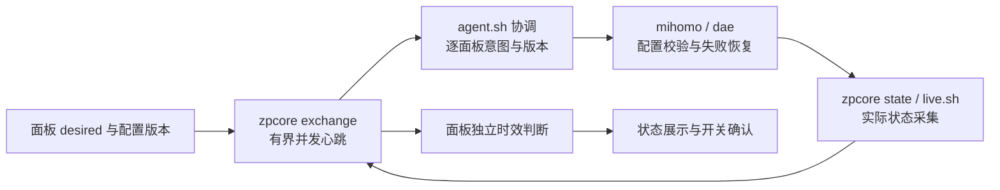

# 路由器连接架构改造：客户端 1.4.61 / zpcore 1.4.0

日期：2026-11-19。本文依据本地源码与隔离故障测试，不把旧报告中的真机结果当作本版验收。

## 结论与实施范围

当前体验问题主要来自控制链路的耦合：网络请求、配置校验、服务启停、诊断都挤在同一个 Shell 循环里；状态证据的时效又与订阅下载混在一起。更换代理协议或刷新界面不能解决这些问题。

本次完成第一阶段可运行改造：将心跳网络交换迁入原生 Go 模块，明确独立状态时效，修正断线状态机和跨面板控制意图，并改进面板开关确认流程。配置协调仍由现有 Shell 实施。本版不是全部客户端已经迁成常驻 Go agent。

## 原有链路与真实限制

| 环节 | 当前拥有者 | 审查结论 |
| --- | --- | --- |
| 引导、配对、安装、升级 | `router-install.sh` 与面板 `/c/*` | 路由器主动出站接入面板；SSH 只是首次粘贴安装命令的入口，并非面板的日常控制连接 |
| 心跳、配置协调、代理启停 | procd 启动 `runtime/agent.sh` | 原来逐台面板串行请求，每台可重试三次、单次 20 秒；故障面板会拖住后面的健康面板 |
| 本地管理与状态采集 | Go `zpcore serve/state`、LuCI/CGI 兼容路径 | 已有原生模块，但原来的网络控制循环仍在 Shell 中 |
| 配置生成、校验、回退 | `agent.sh`、mihomo 与 init 脚本 | 已有配置校验、逐面板版本与旧配置恢复；应保留行为，不能因重写丢失 |
| 透明接管 | mihomo TUN / nft TPROXY / iptables REDIRECT；可选 dae | 是否控制在线、是否进程运行、是否规则接管、是否实际出网是不同证据 |
| 面板设备状态 | `devices.py`、`routes.py` | 订阅下载与心跳原来共用 last_seen；下载能掩盖失联。实际运行与覆盖证据没有独立过期判断 |
| 交互确认 | `views/clients.js` | 原来每 3 秒 setInterval，慢请求可重叠；最多 12 次尝试的计数也可能早于正常同步窗口结束 |

其他仍存在的结构性债务：

- 配置/Geo 资源下载、语法校验、运行就绪等待会阻塞下一次心跳；12 秒仅约束网络交换阶段。
- agent、CLI、本地管理入口可能同时修改数据面；尚未建立一个统一的写入协调者。
- Shell 通过文本拼 JSON、通过 sed 抽字段；本版原生侧验证回执，但未替换所有 Shell 解析。
- 原生进程每轮启动一次，连接复用只覆盖该轮重试，尚未跨轮常驻。
- 现有 TLS 证书错误自动兼容降级策略仍保留；长期应改为配对时建立明确的证书信任。
- 未新增持久化操作 ID 与任务回执。开关确认仍以新鲜的 desired/actual 收敛为准。

## 本版实现

### 原生传输模块

接口：`zpcore exchange --servers <凭据目录> --spool <私有临时目录>`。

Shell 为每个凭据文件写同名 `.request`。Go 读取凭据和请求，将成功回执原子发布为 `.response`，失败写 `.error`。凭据不通过新命令的命令行参数传递；临时目录采用 0700，文件采用 0600，正常退出和 TERM/INT 时清理。

- 单轮总预算 12 秒，覆盖网络请求、排队与退避。并发上限 8，最多接受 32 个面板请求。
- 单次请求预算 3.5 秒，最多三次尝试；网络错误、5xx 和 429 在总预算内短暂抖动后重试。
- 401/403、重定向、其他业务错误与协议格式错误直接结束该面板请求。
- 不跟随重定向；不继承代理环境变量，避免控制连接意外依赖代理环境。
- 请求/响应各限制 64 KiB；只有 HTTP 200、合法 JSON、布尔 desired 与 16 位十六进制 rev 才算有效回执。
- 成功重试会清除前一次错误；失败不会遗留上轮成功回执。
- 原生模块默认验证证书。Shell 显式传入 `--legacy-tls` 保留当前安装方式的兼容性，仅证书验证错误触发一次兼容路径，并留下 `.tls` 标记和系统日志。普通 TLS 握手故障不会因此关闭校验。
- 原生件缺失或不支持新命令时使用并发 Shell 兼容路径。旧路径不具备原生的整轮 12 秒保证。

### 控制协调与断线恢复

每台面板的有效 desired 保存到对应 `revisions/<panel-key>.control`，只有意图变化才写闪存。部分面板失联时继续保留其最后明确意图。尤其是 OFF 不会因为其他面板继续返回 ON 而消失。

全部面板失联时保留现有代理状态；本机覆盖仍拥有最高优先级。失败计数改成每轮全部失败才递增、恢复有效回执时归零。轮间等待依次为 5、10、20、30 秒，后续维持 30 秒。轮间等待不包含请求耗时；恢复延迟不能简单宣称等于 5 秒或 12 秒。

原有逐面板 downloaded/staged/applied 版本、配置校验和失败恢复路径继续使用。

### 独立状态证据

| 字段 | 含义 | 谁可以刷新 |
| --- | --- | --- |
| last_seen | 最近可达时间，兼容历史字段 | 心跳或订阅下载 |
| control_seen | 最近控制心跳 | `/c/report`，订阅与性能配置下载不能续期 |
| actual_at | 最近进程运行/停止证据 | 显式携带 actual 的回报 |
| report_at | 最近接管范围等现场证据 | 显式携带 report 的回报 |

默认有效窗口保持 90 秒。时间戳仍沿用约 30 秒的落盘节流，持久视图因此有一定采样粒度，并非逐秒在线探测。

- 新配对设备先显示等待首次心跳。
- 控制心跳失联后，显示控制通道离线，不能据此断言家中代理已经停止。
- 控制心跳在线、运行证据过期时，显示等待状态回报。
- 要显示接管，需要控制在线、运行证据新鲜、覆盖证据新鲜且覆盖范围有效。
- 新鲜的停止证据不需要旧覆盖证据来证明停止。
- 本机覆盖时不再宣称面板开关正在同步。
- 旧记录在接触时兼容迁移；历史时间戳缺失的设备需要重新回报来建立证据。

### 交互确认

提交期间禁用对应开关，防止重复写入；保存后以真实设备回报确认结果。轮询改为请求结束后再安排下一次，最长观察 90 秒，旧操作回包通过操作代数丢弃。设备离线、本机覆盖、超时分别给出对应说明。过期 actual 不会结束确认流程。

## 后续完整原生架构的设计

下一阶段应围绕以下接口收拢，而非继续向主 Shell 循环添加分支：

1. **连接模块**：常驻、每面板独立会话和退避、可取消请求、独立 liveness 采样。配置下载或应用不阻塞心跳。
2. **协调模块**：唯一写入者，合并面板意图与本机覆盖；提交带操作 ID 的任务，返回排队、执行、失败或确认结果。CLI 和本地界面也通过该模块执行变更。
3. **配置事务模块**：候选目录内下载完整资源，校验后暂存；应用后检查运行就绪、接管与固定目标；失败恢复前一份完整候选集合。资源下载、staged 和实际运行版本分别记录。
4. **观测模块**：缓存统一快照，携带采样时间与证据来源；进程、覆盖、DNS、入口、出口分别报告，避免用进程存在代替实际连通性。
5. **入口适配**：Shell 保留安装与系统工具调用；Go 逐步接管状态和协调；面板/LuCI 使用同一操作与证据契约。

完整迁移需要同时验证：单/双面板、部分与全部失联、撤销凭据、本机覆盖、配置失败恢复、agent 重启、路由器重启、fw4 reload、标准/性能模式、TCP/UDP 与 IPv4/IPv6。先在隔离路由器验证，再做有回退能力的实际升级。

## 验证与部署边界

本次验证记录见文末结果。自动测试与浏览器结果不能证明真实 OpenWrt 长期稳定性、LAN 全设备接管或 WAN 吞吐提升。

部署时需要同时更新面板代码和路由器客户端。单独更新面板只能获得时效判断和界面反馈；原生传输与控制意图缓存需要路由器升级到 1.4.61，并获得 zpcore 1.4.0。六种架构的原生制品及 SHA256SUMS 随本地代码提供。本次没有部署到服务器或真实路由器。

### 本次实际结果

| 验证 | 结果 | 边界 |
| --- | --- | --- |
| `scripts/real_kernel_check.py --all` | 770 passed, 8 skipped，174.80 秒 | Xray v26.11.9、Hysteria app/v2.14.0 使用本机真实内核；8 项 sing-box 配置检查因未提供真实 sing-box 二进制跳过 |
| 最新连接、Shell 与前端行为专项 | 56 passed | 包含全套运行后新增的丢失 POST 回包确认、离线面板恢复与退避归零测试；与全套存在重叠，不能相加 |
| Go `go test -race -timeout 60s ./...` | 通过 | 含慢面板隔离、瞬态错误重试、错误/超大回执拒绝、重定向与认证失败、显式 TLS 兼容策略 |
| Go `go vet ./...` | 通过 | 静态检查 |
| Chromium `scripts/clients_check.cjs` | 34/34 | 临时面板，覆盖实际配对/开关交互及等待、离线、过期状态展示 |
| `scripts/router_install_check.py` | 201/201 | 隔离文件系统、模拟固件和数据面替身，原生 zpcore 使用本机实构建；包括安装/升级/双面板/故障恢复/状态矩阵 |
| 六架构分发制品 | 全部构建、自检及摘要校验通过 | arm64、armv7、armv6、amd64、mips、mipsle；交叉构建不等于每种路由器实机运行验收 |
| 工作树发布清单 | 已同步，校验测试通过 | 随面板 v2.17.0 发布；本次未部署真机 |

首次安装演练被中断后已重新完整执行，上表 201/201 取自完成的那一次，未把中断运行计为通过。模拟性能模式的出口地址和进程由测试替身提供，不是实际 WAN 或 eBPF 性能验证。

仍需真实 OpenWrt 上的断网恢复、重启、fw4 reload、实际 LAN 接管与持续运行验收；本次未测量吞吐或承诺长期稳定性提升幅度。
