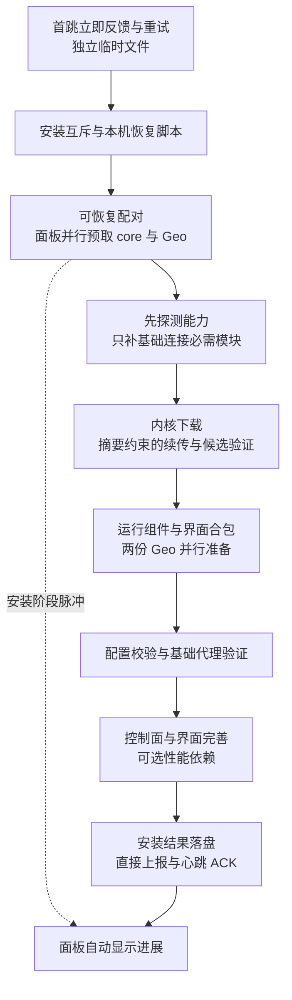

# 新路由器安装接入改造：客户端 1.4.62

日期：2026-11-19。本次继续在 1.4.61 连接与状态架构改造基础上，改造新路由器的安装入口、配对事务、资源传输和反馈流程。随面板 v2.17.0 发布；本次未部署到真实服务器或路由器。

## 已确认的问题

| 问题 | 实际复现 | 本版处理 |
| --- | --- | --- |
| 配对已提交但响应丢失，再次执行被拒绝 | 第一次 `/c/pair` 返回成功，丢弃响应后重试得到 403；刷新设备页还会清理恢复依据 | 给同一次安装生成私有随机请求证明，受限窗口内恢复同一设备与凭据，不重复创建设备 |
| 能力已存在仍刷新源、装模块 | 执行真实 `install_deps`，TUN 等探测成功仍记录 update/install 调用 | 先探测，缺失才安装；已有 TUN 时用不到的 TPROXY 补充模块也推迟到基础验证后 |
| 内核流传输中断后丢弃前缀 | 本地 HTTP 服务发送一半后关闭连接，原函数直接失败 | 有 curl、SHA 工具和可信摘要时，使用 Range 继续同一内容，保持总请求预算与最终完整性验证 |
| 新内核未验证就移除旧文件 | 候选内核执行 `-v` 失败后，旧文件已不存在 | 先生成 `.new` 并执行验证，最后原子替换；更新空间不足时保留旧内核并说明原因 |
| 证书验证失败被当作丢包重试五次 | curl 模拟返回 60，先等待 1+2+3+4 秒，再进入已有证书兼容路径 | 51/60 立即交给现有证书策略，移除这条路径固定的 10 秒重试等待；普通握手错误不因此关闭校验 |
| 可选步骤在代理验证之前串行等待 | 原 main 在 verify 前安装本地控制面和界面；BTF 在基础能力阶段下载 | 基础配置和代理先验证，再完善本地控制面、界面与性能能力 |
| 多次请求和重复资源传输 | 运行脚本已有独立 bundle，但 7 份界面文件仍分别请求；两份 Geo 串行 | `bundle?ui=1` 合并 10 份运行组件和 7 份界面文件；Geo 两路并行；相同版本 zpcore 跳过下载 |
| 只有终端日志，没有安装任务状态 | 配对后设备卡只能等待常规心跳 | 增加独立安装阶段、耗时、错误和进度失联状态；终态保存并由心跳补报确认 |

以上是源码与隔离故障复现结论，不是对某条真实 WAN 线路的吞吐测量。

## 新流程

配对之前的环境或连接错误仍在终端显示；配对成功后，面板自动出现设备和安装阶段。安装进度不刷新 `control_seen`，也不能把设备标成代理已连接。实际连接、运行与接管判断继续使用 1.4.61 的独立证据与时效规则。

## 配对恢复协议

- 新客户端在路由器本地生成 256 位请求证明，放在 `.pair/<code>`，目录 0700、文件 0600。
- `/c/pair` 接收可选 `request_id`。首次成功仍只创建一个设备。重复提交相同 code 与相同请求证明，可恢复同一 ID 和 secret。
- 服务端仅保存请求证明的 SHA256 和设备 secret 的 SHA256，不保存明文证明或明文 secret。恢复时用请求证明、code 与设备 ID，通过 HMAC-SHA256 重建并校验凭据。
- 恢复窗口为成功配对后的 15 分钟，并且不超过原配对码到期时间。
- 其他请求证明、缺少证明、过期、设备已移除或凭据已变更均不能恢复该凭据。旧客户端不提供 request_id 时仍是原有一次性语义。
- 设备页清理旧配对码时保留有效恢复依据。恢复不会新增设备，也不会重复记录接入审计。
- 写入两份本地凭据时均先写私有候选文件，再重命名。若写入中断，可利用已保存的凭据或请求证明继续。

恢复能力要求面板和路由器客户端一起更新。旧面板会忽略新请求字段，不能提供该恢复协议。

## 安装互斥与恢复

首跳命令使用独立 mktemp 文件，避免两次操作覆盖正在执行的下载脚本，并立即打印连接反馈。原有短命令、五次 GET 重试与工具错误输出保留。

安装使用原子符号链接锁，记录进程与启动身份；陈旧拥有者可恢复，恢复动作另有互斥，避免两份安装同时替换文件。受控退出时释放锁。

安装入口保留一份 0600 的 `install-resume.sh`。失败时终端显示本机继续命令；该文件可以复用已保存的凭据和内核，不必重新下载首跳脚本。成功完成后删除本机恢复脚本。若首次配对回包丢失且恢复窗口已过，仍需新配对码；若凭据已成功保存，恢复脚本可继续复用凭据。

安装不是系统级全量回滚事务：已装好的系统包与有效资源会保留供下次复用，不会在失败时卸载。配置、内核和界面文件仍按各自候选验证与原子替换规则处理。

## 下载与资源准备

### 内核

- 压缩包前缀可跨重试或重跑保留，旁边只记录期望内容摘要。
- 仅在 curl、完整摘要和 SHA 校验工具齐备时启用续传。摘要变化则清理旧前缀；没有条件时走正常完整下载。
- 支持 Range 的服务器返回 206 时继续追加；不支持 Range 时清理前缀并重新完整下载，避免拼接重复内容。
- 416 仅允许进入最终完整校验，不能单靠文件大小判定成功。
- 每次交换仍受下载预算约束，失败保留已下前缀；完成后仍走完整摘要、压缩包和可执行验证。
- 当前工作内核不再提前删除。候选内核验证通过后才重命名替换。安全升级需要额外暂存空间；首次安装的空间估算会考虑已分配的压缩包前缀。

故障测试发送 1,310,720 字节，第一次在 655,360 字节断流，第二次请求明确从 `bytes=655360-` 继续，最终文件逐字节一致。这证明恢复路径，不是 WAN 速率提升比例。

### 合并与并行

`/c/rt/bundle?ui=1` 返回一份带整体 SHA256 的运行组件和界面压缩包。旧的 `/c/rt/bundle` 保持原有内容契约。客户端验证整包后缓存界面文件，后续安装界面优先取缓存；旧服务端仍可回退单文件接口。

GeoIP 与 GeoSite 各自在独立子 shell 下载，隔离全局变量、临时文件与响应头；分别校验、原子替换。收到摘要时必须匹配。单份失败仍按原有本地复用或降级配置策略处理。

本地 zpcore 可执行且版本与面板元数据相同，则不再重复下载其压缩包。本轮没有改变 Go 二进制源码，继续使用上一轮已构建的 zpcore 1.4.0。

### 等待预算与可选步骤

小型 curl 请求的连接等待为 3 秒，大文件连接等待为 5 秒；传输本身另有预算。非 curl 下载器增加外层进程等待与终止处理，不能仅依赖工具的网络读超时。

软件源索引更新等待 30 秒，包安装等待 60 秒，超时先终止，再强制结束直接命令进程。外部包管理器的所有后代进程是否完整回收仍需固件实测。

本地控制面下载默认预算 60 秒；界面补充下载共享默认 30 秒预算。这些是下载预算，不包含本地服务启动与探测时间。可选失败会保留已有可用文件或使用兼容入口。BTF 等可选性能能力在基础代理验证之后准备，不能据此承诺整个安装固定一分钟完成。

## 安装任务与结果确认

新增 `/c/install/report`，只认设备凭据，数据限于固定阶段和状态。每次安装有独立 id 和递增 seq：

- 阶段：paired、dependencies、core、runtime、verify、controller、ui、optional、ready。
- 状态：running、failed、completed；超过 120 秒未收到运行进度，视图显示 interrupted。
- 同一次安装的旧序号不能覆盖新阶段，终态不能被迟到的 running 覆盖。最近已替换的安装 id 被隔离，防止旧任务回包恢复旧界面。
- 后台脉冲约每 5 秒发送当前阶段，服务端至少隔 15 秒才为重复脉冲更新存储。
- 直接上报失败不阻塞基础安装，单次上报有短超时。
- 终态另存为不含凭据的本机回执，并原子更新当前尝试指针；运行中的 agent 可随心跳继续补报。服务端返回 installation_ack 后删除对应尝试文件。文件名含尝试 ID，旧 ACK 不会删除新回执。
- 损坏的可选回执会被过滤或忽略，不能作为执行命令或修改代理状态的依据。

面板显示当前阶段和已用时，自动刷新，不制造没有依据的百分比。基础验证后明确显示正在完善哪些组件；完成安装流程仍要求用户从真实 LAN 终端确认实际出网。

## 本地验收结果

本版实际结果将在本节记录。自动验收不等于真实 OpenWrt、弱网、掉电和长期运行验收。

| 验收 | 实际结果 | 范围 |
| --- | --- | --- |
| 全量后端，带本机真实 Xray/Hysteria | 787 passed, 8 skipped，168.94 秒 | 8 项因缺少真实 sing-box 二进制跳过；未把它们记为通过 |
| 安装／运行脚本／TLS 相关专项 | 110 passed，10.77 秒 | 包含证书错误不走丢包重试，普通 TLS 握手错误保持原验证策略等回归 |
| 最终安装故障专项 | 17 passed，2.46 秒 | 含丢失配对回执、恢复过期、不存明文证明、安装进度隔离、Range 与不支持 Range、并发与陈旧锁、新内核失败保留旧文件、终态补报、旧 ACK 隔离、损坏回执过滤、本机恢复脚本生命周期 |
| Chromium 设备页 | 36/36 | 新设备安装阶段自动出现，安装中不显示绿色连接，既有开关、版本和主题行为正常 |
| 隔离路由器安装演练 | 201/201 | 首次安装、升级、双面板、包管理器、BTF、性能模式回退、LuCI 与状态矩阵；固件命令与数据面包含替身 |
| 发布清单校验 | 通过 | SHA256SUMS 与当前代码树一致；随面板 v2.17.0 发布 |

各组测试有重叠，不能将数量相加。全量运行后新增的证书与恢复等用例已由专项执行；最终故障专项包含当前全部 17 个安装用例。

首次演练在旧夹具将主流程裁剪到可选准备之前时暴露 BTF 检查失配；已将夹具调整为显式执行可选准备，然后重新完整执行至 201/201。浏览器夹具也改为等待实际回报状态，避免因安装卡片提前出现而提前读取旧状态。没有把这些未完成或失败运行当作通过。

## 完成与真实环境边界

可以确认：本地实现与上述自动验收已完成，既有连接层改造保留。本次没有在真实路由器或生产面板执行安装、升级、重启或网络切换。

仍需要真实设备上的首装、低带宽／丢包、SSH 断开、断电恢复、系统重启、fw4 reload、LAN 多终端出网和 24–72 小时持续运行验收。不同下载工具的实际续传支持、包管理器的子进程行为、固件依赖源与可用空间也需要实测。当前没有真实 WAN 安装耗时或吞吐对比，不能据此承诺所有设备固定时间完成或已经达到“完美稳定”。

复现入口：`backend/tests/test_router_onboarding.py`、`scripts/clients_check.cjs`、`scripts/router_install_check.py`、`scripts/real_kernel_check.py --all`。
